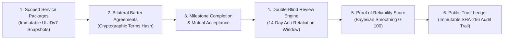

# Trade Weft 🧶

> **The B2B Service Barter Marketplace for Africa**  
> *Exchange high-value professional services without cash, build tamper-evident reputation, and preserve working capital.*

[-black?style=for-the-badge&logo=next.js)](https://nextjs.org/)
[](https://react.dev/)
[](https://www.typescriptlang.org/)
[](https://tailwindcss.com/)
[](https://supabase.com/)
[](https://developer.safaricom.co.ke/)
[](https://upstash.com/)
[](https://vitest.dev/)
[](https://www.netlify.com/)

---

## 🌍 The Story & The Problem

Across Nairobi and the broader African startup ecosystem, early-stage companies, creative agencies, and elite independent consultants face a shared paradox: **they possess valuable billable capacity, but suffer from chronic liquidity constraints.**

- A software engineering shop needs corporate tax advisory and commercial contract drafting.
- A commercial photography studio needs a high-performance web platform and SEO growth marketing.
- A brand design agency needs cybersecurity auditing and cloud infrastructure provisioning.

In traditional markets, each must part with scarce cash reserves to procure these services. Traditional informal barter attempts consistently collapse due to **trust asymmetry, scope creep, retaliatory reviews, and lack of legal enforceability.**

**Trade Weft was built to solve this.** It provides a modern, institutional-grade commercial barter platform where verified businesses exchange scoped services with zero platform commissions on trades, underpinned by immutable version snapshots, double-blind reviews, and a cryptographic public trust ledger.

---

## ✨ Key Features & Capabilities



### 1. Strictly Scoped Service Packages (`src/features/packages`)
- **Deliverables & Exclusions**: Services are posted with fixed deliverables, turnaround times, monthly capacity, indicative KES valuations, and explicit out-of-scope exclusions.
- **Mutual Need Matching**: Each package identifies up to 5 reciprocal categories sought in exchange, powering automated mutual matchmaking algorithms.
- **Immutable Version Snapshots (`service_package_versions`)**: Whenever a provider updates a package, an immutable snapshot is preserved. Barter contracts bind to the exact version snapshot active when the trade was proposed, preventing post-agreement scope manipulation.

### 2. Bilateral Barter Agreements (`src/features/agreements`)
- **Legally Grounded Trade Workflow**: Proposal → Review & Revision → Bilateral Signing → In-Progress Milestone Tracking → Dual Acceptance Completion.
- **Cryptographic Terms Hashing**: Acceptance computes an immutable SHA-256 hash (`terms_hash`) over frozen deliverables, obligations, and milestones.
- **Row-Level Security Enforcement**: Agreement data is strictly isolated to the two participating parties at the database level via Postgres RLS.

### 3. Double-Blind Review System (`src/features/trust`)
- **Anti-Retaliation Protection**: When a trade completes, both parties have 14 days to submit ratings across 4 dimensions: *Quality of Work*, *Communication*, *Timeliness*, and *Scope Adherence*.
- **Fairness Guarantee**: Reviews remain cryptographically sealed until **both** parties submit or the 14-day window closes. A 1-hour grace period allows edits or withdrawals before irreversible publication.

### 4. Proof of Reliability Engine (0–100)
- **Bayesian Smoothing**: Score incorporates Bayesian shrinkage ($C = 80.0$, $m = 5$) to prevent gaming from low-volume exchanges.
- **Recency Decay**: Historical performance decays smoothly ($t_{1/2} = 12\text{ months}$), rewarding continuous consistency.
- **Trading-Pair Dampening**: Multiple trades between the same two parties apply a $1/k$ dampening factor to eradicate collusion and review rings.
- **Minimum Threshold Gate**: Reputation scores unlock publicly only after $\ge 3$ distinct trading partners have verified trades.

### 5. Multi-Platform External Proof of Work (`src/features/verification`)
- **12 External Portfolio Integrations**: GitHub, Figma, Behance, Dribbble, LinkedIn, Instagram, Facebook, TikTok, YouTube, X, Google Business Profile, and custom personal websites.
- **Standalone GitHub PKCE OAuth**: Custom implementation isolated from user auth. Validates account age ($\ge 30\text{ days}$) and discards access tokens immediately after identity verification (zero token persistence).
- **Socket Connect-Time SSRF Defense (`safeFetch`)**: Automated custom domain verification (`/.well-known/tradeweft-verification.txt`) using Node socket-level IP resolution to strictly block loopback, RFC1918, AWS/GCP metadata (`169.254.169.254`), CGNAT, and IPv4-mapped IPv6 ranges.
- **Sandboxed Evidence Queue**: Manual verification workflow with 48-hour SLA tracking for platforms requiring human review.

### 6. Two-Stage Media Pipeline (`src/features/media`)
- **Quarantine-First Ingestion**: Client uploads pass directly to a private, short-lived `quarantine` bucket via presigned URLs.
- **Server-Side Finalization (`/api/media/finalize`)**: Server verifies real magic bytes (rejecting SVGs and polyglots), protects against decompression bombs ($\le 6000\text{px}$), strips EXIF GPS metadata, generates responsive WebP variants, and computes base64 blur placeholders via `sharp`.
- **Storage Quotas**: Automated trigger-enforced quotas (max 100 assets / 200 MB per provider).

### 7. Monetization with Trust Isolation Firewall (`src/features/payments`)
- **0% Platform Fee Core**: Platform trades remain 100% cash-free and commission-free.
- **Safaricom Daraja 2.0 Integration**: Native M-Pesa STK Push (`Lipa Na M-Pesa Online`) for optional provider visibility tools:
  - **Top Ads (Pinned Placements)**: 7, 14, or 30-day city/category promotions. Strictly capped at 3 concurrent slots per category/city via database exclusion constraints (`btree_gist`). Overbooking is physically impossible.
  - **Boost Listing Tiers**: Prepaid capacity plans (Basic, Pro, Enterprise) governing active package allocations.
- **Strict Trust Firewall**: Monetization is completely decoupled from reputation. Money cannot buy, alter, or influence review ratings, Proof of Reliability scores, verification badges, or search match rankings.
- **Financial Auditability**: All monetary amounts are stored in integer minor units (`amount_minor`), recorded in an append-only `payment_ledger` with triggers blocking `UPDATE` and `DELETE`.

---

## 🛠️ Architecture & Engineering Deep Dive

### High-Level Architecture

```
┌────────────────────────────────────────────────────────────────────────┐
│                          Next.js 16 App Router                         │
│                  React 19 Server & Client Components                   │
│                                                                        │
│   src/app/                                                             │
│   ├── (marketing)/    --> High-performance edge marketing pages       │
│   ├── (auth)/         --> Google PKCE OAuth & Email/Password           │
│   ├── (app)/dashboard --> Protected provider workspaces               │
│   └── (app)/admin     --> Role-restricted moderation consoles          │
└──────────────────┬──────────────────────────────────┬──────────────────┘
                   │                                  │
    HTTP / Server Actions                       Sliding Window Limits
                   ▼                                  ▼
┌──────────────────────────────────────┐   ┌─────────────────────────────┐
│  Data Access Layer (src/server/dal)  │   │  Upstash Redis Rate Limiter │
│  - Strict Zero-IDOR Enforcement      │   │  - 15-30 req/min sliding    │
│  - supabase.auth.getUser() Checks    │   │  - Fail-closed in prod      │
│  - Zod Input Boundary Validation     │   └─────────────────────────────┘
└──────────────────┬───────────────────┘
                   │
         PostgREST / Supabase Client
                   ▼
┌────────────────────────────────────────────────────────────────────────┐
│                   Supabase Managed PostgreSQL                          │
│                                                                        │
│  - Time-ordered UUIDv7 Primary Keys                                   │
│  - Granular Row-Level Security (select auth.uid())                     │
│  - Full-Text Search with Multilingual English/Swahili Vectors          │
│  - btree_gist Exclusion Constraints (No Top-Ad Overbooking)           │
│  - Immutable Outbox Pattern (domain_events + SKIP LOCKED workers)     │
│  - Append-Only Financial Ledgers (Triggers blocking mutations)         │
└────────────────────────────────────────────────────────────────────────┘
```

### 1. Strict Zero-IDOR Security Model
Trade Weft treats client assertions and route middleware purely as routing hints, **never** as security boundaries (eliminating vulnerabilities such as CVE-2025-29927).
- Real authorization lives exclusively in the `server-only` Data Access Layer ([`src/server/dal.ts`](file:///c:/Users/Admin/Desktop/startups/tradeweft/src/server/dal.ts)).
- Every protected Server Component, Server Action, and Route Handler verifies session identity via `supabase.auth.getUser()`, cross-referencing tenant UUIDs against PostgreSQL Row Level Security (`(select auth.uid())`).
- Admin endpoints (`/admin/*`) enforce role verification (`requireVerifierOrAdmin()`, `requireFinanceOrAdmin()`) and return an opaque `404 Not Found` for unauthorized sessions to thwart reconnaissance.

### 2. Feature-Isolated Domain Architecture
The codebase strictly follows a domain-driven feature folder pattern:
```
src/features/<feature-name>/
├── actions/        # Server Actions with strict Zod boundary validation
├── components/     # UI components (Client & Server)
├── data/           # Constants and lookup tables
├── queries/        # Server-only Data Access Layer fetchers
├── schemas/        # Zod validation contracts
├── types/          # Domain TypeScript type definitions
└── index.ts        # Explicit public module boundary
```
Features never import private internals across feature boundaries. Shared foundational utilities reside strictly in `src/lib/`.

### 3. Pan-African Expansion by Data, Not Code
The database schema decouples geography from application logic:
- `countries` and self-referential `locations` tables support hierarchical administrative structures (Country → County/State → City/Municipality → Neighborhood/Sub-county).
- Expanding Trade Weft from Kenya (`KE`) to Uganda (`UG`), Tanzania (`TZ`), Nigeria (`NG`), or South Africa (`ZA`) requires **zero application code modifications**—only database seed rows for currency codes, phone prefixes, timezones, and administrative geo-hierarchies.

### 4. Zero-Red Brand Discipline
In accordance with [`DESIGN.md`](file:///c:/Users/Admin/Desktop/startups/tradeweft/DESIGN.md), Trade Weft enforces strict, warm B2B styling:
- **Primary**: Deep Pine Green (`#01796F`) conveying organic growth, stability, and mutual prosperity.
- **Accents & Alerts**: Deep Amber (`#B45309`) for warnings, system alerts, and pending states.
- **Absolute Rule**: **Zero red anywhere in the UI**. Alerts and destructive actions are paired with unambiguous iconography and explanatory microcopy rather than aggressive warning reds.
- **Automated CI Enforcement**: A custom Vitest audit ([`tests/audit/zero-red.test.ts`](file:///c:/Users/Admin/Desktop/startups/tradeweft/tests/audit/zero-red.test.ts)) scans the entire repository during build, failing any commit containing red hexes or Tailwind red utility classes.

---

## 💻 Tech Stack Matrix

| Layer | Technology | Key Capabilities & Justification |
| :--- | :--- | :--- |
| **Framework** | **Next.js 16.4.0** | App Router, Turbopack, React Server Components, Server Actions |
| **Core UI** | **React 19.3.0** | Concurrent rendering, Server Actions, modern form hooks (`useActionState`) |
| **Language** | **TypeScript 5.9.3** | Strict mode, end-to-end schema validation, zero `any` policy |
| **Styling** | **Tailwind CSS v4** | CSS-first configuration, logical properties (`ms-*`, `me-*`), Poppins typography |
| **Database & Auth** | **Supabase (PostgreSQL 15+)** | Row Level Security (RLS), Google OAuth PKCE, Full-Text Search, UUIDv7 |
| **Payments** | **Safaricom Daraja 2.0** | M-Pesa Express STK Push, untrusted callback reconciliation, immutable ledger |
| **Rate Limiting** | **Upstash Redis** | Serverless sliding-window rate limiters; fails closed in production |
| **Media Processing**| **Sharp 0.35.5** | Secure WebP transformation, EXIF GPS stripping, blurhash placeholders |
| **Validation** | **Zod 3.24.2** | Runtime input boundary validation across forms, actions, and API routes |
| **Internationalization**| **Next-Intl 4.14.9** | Translatable string catalogs (English & Swahili), localized formatters |
| **Testing** | **Vitest 5.0.3** | 30 test suites, 223 unit/integration/hostile-security tests |
| **Deployment** | **Netlify** | Next.js Advanced Runtime (v5.16), Node 22 ESM environment |

---

## 📂 Repository Structure

```
tradeweft/
├── docs/                             # Engineering documentation
│   ├── ARCHITECTURE.md               # Deep-dive architecture & data flows
│   ├── PERFORMANCE.md                # Benchmarks & optimization thresholds
│   ├── RUNBOOK-PAYMENTS.md           # Daraja M-Pesa operational runbook
│   └── SETUP.md                      # Cloud & credential provisioning guide
├── public/                           # Static assets, category cards, hero imagery
│   └── images/                       # Optimized visuals & WebP category backgrounds
├── src/
│   ├── app/                          # Next.js App Router route trees
│   │   ├── (marketing)/              # Full-bleed landing, capabilities directory, trust explainer
│   │   ├── (auth)/                   # Login, signup, PKCE OAuth handlers, auth error boundaries
│   │   ├── (app)/                    # Authenticated dashboard, packages, trades, agreements
│   │   ├── admin/                    # Ops verification console, review moderation, finance logs
│   │   └── api/                      # Webhooks (Daraja callback), cron dispatchers, health endpoints
│   ├── components/                   # Shared UI primitives, layout wrappers, intl providers
│   ├── features/                     # Domain-driven feature modules
│   │   ├── admin/                    # Platform verification queues and moderation consoles
│   │   ├── agreements/               # Barter contracts, terms hashing, milestone revisions
│   │   ├── auth/                     # Supabase session handlers and Google OAuth PKCE
│   │   ├── media/                    # Sharp media pipeline, quarantine validation, WebP variants
│   │   ├── onboarding/               # Cascading location selection, profile completion
│   │   ├── packages/                 # Service listings, category taxonomy, search RPCs, UUIDv7 versions
│   │   ├── payments/                 # Daraja M-Pesa adapter, Top Ads slot allocations, ledger triggers
│   │   ├── trust/                    # Double-blind reviews, Proof of Reliability scoring, public ledger
│   │   └── verification/             # External portfolio registry, standalone GitHub PKCE, safeFetch SSRF
│   ├── i18n/                         # Next-intl routing, request handlers, message dictionaries
│   ├── lib/                          # Security utilities, rate limiting, fonts, design tokens
│   └── server/                       # Data Access Layer (dal.ts), feature flags, database clients
├── supabase/                         # Database migrations, seed data, and schema definitions
│   └── migrations/                   # Production-tested SQL migrations (RLS, RPCs, Triggers)
├── tests/                            # Vitest security & architectural test suites
│   └── audit/                        # Auth matrix, zero-red compliance, hostile security probes
├── netlify.toml                      # Netlify build and deployment runtime configuration
└── package.json                      # Dependency manifests & build scripts
```

---

## 🚀 Getting Started & Local Development

### Prerequisites
- **Node.js**: `v22.0.0` or higher (Node 22 LTS recommended)
- **Package Manager**: `npm` (v10+)
- **Supabase Account**: With a local CLI or hosted Postgres instance
- **Upstash Redis**: Serverless Redis instance for rate limiting

### 1. Clone the Repository
```bash
git clone https://github.com/ObozKE/tradeweft.git
cd tradeweft
```

### 2. Install Dependencies
```bash
npm install
```

### 3. Environment Configuration
Create a `.env.local` file in the project root:
```bash
# Supabase Configuration
NEXT_PUBLIC_SUPABASE_URL=https://<your-project-id>.supabase.co
NEXT_PUBLIC_SUPABASE_ANON_KEY=eyJhbGciOiJIUzI1NiIsInR5cCI6IkpXVCJ9...
SUPABASE_SERVICE_ROLE_KEY=eyJhbGciOiJIUzI1NiIsInR5cCI6IkpXVCJ9...

# Upstash Redis Rate Limiting
UPSTASH_REDIS_REST_URL=https://<your-db>.upstash.io
UPSTASH_REDIS_REST_TOKEN=AXi...

# Application URLs & CORS
ALLOWED_ORIGINS=http://localhost:3000
NEXT_PUBLIC_SITE_URL=http://localhost:3000

# Safaricom Daraja M-Pesa (Optional for Local Mock Mode)
DARAJA_USE_MOCK=true
DARAJA_ENV=sandbox
DARAJA_CONSUMER_KEY=dummy_consumer_key
DARAJA_CONSUMER_SECRET=dummy_consumer_secret
DARAJA_SHORTCODE=174379
DARAJA_PASSKEY=bfb279f9aa9bdbcf158e97dd71a467cd2e0c893059b10f78e6b72ada1ed2c919
DARAJA_CALLBACK_SECRET=dev_callback_secret_token_12345
DARAJA_CALLBACK_BASE_URL=http://localhost:3000
```

### 4. Database Setup
Apply the migrations in `/supabase/migrations` to your Supabase instance:
```bash
npx supabase db push
```

### 5. Start the Development Server
```bash
npm run dev
```
Open [http://localhost:3000](http://localhost:3000) to view the application in your browser.

---

## 🧪 Testing & Verification

Trade Weft maintains an exhaustive automated testing suite with **223 unit, integration, and security tests** across 30 test files:

```bash
# Run complete Vitest suite
npm test

# Run tests in watch mode
npm run test:watch

# Run TypeScript typecheck
npm run typecheck

# Run ESLint validation
npm run lint

# Execute full production build
npm run build
```

### Automated Architectural Audits
1. **Zero-Red Design Audit (`tests/audit/zero-red.test.ts`)**: Enforces brand styling by testing that no component, CSS file, or layout renders unauthorized red tones.
2. **Hostile Security Audit (`tests/audit/hostile-security.test.ts`)**: Probes input boundaries against SQL injection, SSRF bypasses, prototype pollution, and path traversal attacks.
3. **Authorization Matrix Audit (`tests/audit/auth-matrix.test.ts`)**: Validates that all server actions and data routes enforce proper role-based privilege boundaries.

---

## 🛡️ Security & Responsible Disclosure

Trade Weft is engineered with a defense-in-depth posture:
- **Zero Token Persistence**: Third-party OAuth tokens (e.g., GitHub verification) are validated in-memory and immediately destroyed.
- **SSRF Hardening**: Custom website verification uses socket-level IP resolution to prevent attackers from targeting internal network resources or cloud metadata endpoints.
- **Cryptographic Terms Integrity**: Barter contracts stamp an SHA-256 digest of terms upon signing.
- **Append-Only Ledgers**: Monetary and reputation ledger records cannot be modified or deleted once inserted.

---

## 👨‍💻 Author & Creator

**Martin Kiplangat (`@ObozKE`)**  
*Full-Stack Systems Engineer & Product Builder*  
📍 Nairobi, Kenya  
- **GitHub**: [@ObozKE](https://github.com/ObozKE)  
- **Email**: martinkiplangat45@gmail.com  

---

<p align="center">
  <sub>Built with care in Nairobi for the future of African commerce. 🇰🇪</sub>
</p>
